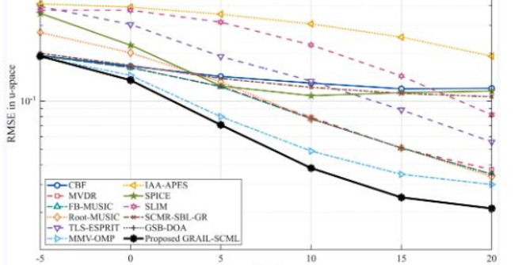

# GRAIL-SCML: An Adaptive Geometry-Regularized Integrated Likelihood for Doppler Direction Estimation[with MATLAB Code]

GRAIL-SCML: A Geometry-Regularized Adaptive Integrated Likelihood for Waveform Direction Estimation Algorithm TL; DR: GRAIL-SCML is an algorithm for high-precision DOA estimation that integrates deterministic maximum likelihood, covariance domain fitting, weak geometric regularization and evidence-supported set selection. It comprehensively outperforms traditional methods in extreme scenarios such as low signal-to-noise ratio, single quick capture, strong correlation, non-uniform noise etc. 1. Introduction: What is DOA estimation? Direction-of-Arrival (DOA) estimation is one of the most core problems in array signal processing, and it is widely used in radar, sonar, wireless communication, microphone arrays and other fields. The basic problem can be described as:
Utilizing a set of spatially distributed sensors (antenna arrays) to receive multiple signals, estimate the incident direction of the signals. In practical applications, DOA estimation faces numerous challenges:
📉 Low Signal-to-Noise Ratio: The signal power is weak, submerged in noise.
🔢 Single Quick Snap: Only a very small number of measurement samples are available.
🔗 High source correlation: Multiple signal sources have a high degree of correlation or even coherence.
📊 Non-uniform noise: The noise power of each element is not consistent.
Traditional methods (such as MUSIC, ESPRIT, MVDR) degrade dramatically under these extreme conditions. GRAIL-SCML is proposed to address these challenges.
2. System Model 2.1 Uniform Line Array (ULA) Narrowband Model Consider a uniform linear array (ULA) composed of an array of elements, with the element spacing being half-wavelength. Assuming there is a far-field narrowband signal source with an incident angle of, the array receives data that can be modeled as:
Among them:
A fast-paced array receiving data matrix
Array manifold matrix (steering matrix)
Signal waveform matrix
Additive noise matrix
The steering vector of ULA is defined as:
The vector can be abbreviated as:
The array manifold matrix is the concatenation of the directional steering vectors:
2.2 Noise model project supports two types of noise models:
Uniform Noise (uniform): The variance of noise for each element is the same.
Non-uniform Noise (nonuniform): The variance of noise for each element varies, with exponential differences (ranging up to).
2.3 Source Correlation Model: The correlation between signal sources is characterized by the correlation coefficient (as an example). 
When, two signal sources are highly correlated (experimentally taken as).
2.4 Bandwidth Model: For broadband signals, the frequency focusing framework is adopted. Under -space, the normalized directional parameters are defined:
The frequency factor is defined as:
Where is the number of frequency subbands, and is the reference frequency parameter. The steering vector for the ith frequency subband is:
3. GRAIL-SCML Algorithm Explanation:
The full name of GRAIL-SCML reveals its core design philosophy:
Abbreviation
Full Name
Meaning
GGeometry-Regularized
Geometry Regularization
RARegularized Adaptive
Regularization Adaptive
ILIntegrated Likelihood
Integrated Likelihood
SCMLStructure-Constrained Maximum Likelihood
Structure Constrained Maximum Likelihood
The algorithm consists of three core modules and two key technologies.
3.1 Waveform-Domain Deterministic Maximum Likelihood (DML) Fitting: Given an angle, the least squares estimate of the signal waveform is:
Therefore, the deterministic maximum likelihood cost function is:
Where is the projection matrix. This cost function measures the degree of fit of the array manifold to the received data—the smaller the value, the closer the selected angle is to the true value.
Intuitive understanding: DML attempts to find a set of angles such that the projection of the signal onto this direction "explains" all observed data.
3.2 Covariance Domain Fitting: Only relying on waveform domain fitting is not robust enough when sample scarcity occurs. GRAIL-SCML introduces covariance domain fitting as a complementary information source.
First, estimate the sample covariance matrix:
Then apply forward-backward averaging:
In which is the anti-identity matrix (the elements on the diagonal are). Next, perform shrinkage regularization:
The idea of covariance domain fitting is to decompose the estimated covariance matrix into signal components and noise components:
By solving the following non-negative least squares problem to obtain power coefficients:
Where, the column vector is. The covariance fitting cost is:
Why need the covariance domain? Waveform domain is sensitive to the randomness of signal waveforms, while the covariance domain can effectively suppress noise fluctuations through statistical averaging, providing more stable gradient directions in low-shot scenarios. 3.3 Weak geometric regularization To prevent estimation values from collapsing (e.g., multiple angle estimates clustering at the same point), introduce two weak regularization terms:
(1) Separation penalty term 
When adjacent angles are too close, this penalty term sharply increases, pushing them apart.
(2) Boundary penalty term 
To prevent search beyond the preset angle range.
Key design: The regularization weights are extremely small (separation penalty weight only, boundary penalty weight but due to low trigger probability has limited impact), ensuring that regularization has almost no effect in normal regions, only providing correction when estimation is about to "go wrong". This is the meaning of "weak regularization". 3.4 Total cost function Combining the above three items into the total objective function:
Default weights are:
Weight design philosophy: DML is primary, COV is secondary (65:35), separation penalty as the last "safety valve". This design balances the accuracy and robustness. 3.5 Continuous support set refinement Traditional DOA methods usually search on discrete grids, limited by grid resolution. GRAIL-SCML uses ungrid continuous optimization to completely eliminate this limitation.
Use Nelder-Mead simplex algorithm (fminsearch) directly in continuous space to minimize:
Search parameters:
Maximum iterations:
Maximum function evaluations:
Angle tolerance:
Function tolerance:
3.6 Evidence-based Selection of Algorithmic Libraries: The GRAIL-SCML employs a multi-initialization strategy and a selection strategy for continuous non-convex optimization, which is highly sensitive to initial values.
Initializer pool includes algorithms (up to the maximum of _ valid results):
Category
Initializer
Feature
Subspace class
FB-MUSIC  
Forward-backward MUSIC
Subspace class
GSB-DOA  
Generalized subspace DOA
Subspace class
Root-MUSIC  
Seek Root MUSIC
Subspace class
TLS-ESPRIT  
Overall Least Squares Esprit
Sparse class
IAA-APES  
Iterative Adaptive Method
Sparse class
SPICE  
Sparse Iterative Covariance Estimation
Wave-like
MVDR (Capon)  
Minimum variance undistorted response
Wave-like
CBF (Bartlett)  
Regular Beamforming
Greedy class
MMV-OMP  
Multi-measurement vector orthogonal matching pursuit
Ordered
Seq-DML  
Order-Deterministic Maximum Likelihood Initialization
Processing flow:
1  
Candidate generation: Run each initializer sequentially to obtain angle estimates.
2  
Candidate cleaning: eliminate duplicate candidates (angle difference considered as duplicate)
3  
Independent Refinement: Run the Nelder-Mead optimizer for each candidate.
4  
Evidence selection: select the result with the smallest cost function after refinement as the final output.
Why is it called "Evidence" selection? The ultimate judgment is based on the total cost function, which integrates both waveform and covariance domain "evidence," selecting the most consistent solution.
4.1 Core difference dimensions
Narrowband GRAIL-SCML
Broadband WB-GRAIL-SCML
Data
Single-frequency array data
Multi-frequency array data
Guidance vector
Search space
(Angle/degree)
(Normalized Frequency)
DML cost
Single-frequency DML
Average DML for each subband
COV cost  
Single-frequency COV  
Average COV across all subbands  
Initializer  
9 narrow-band methods  
4 broad-band methods + Seq-WB  
4.2 Broadband cost function  
Total cost is:  
5. The experimental design and results analysis project provides four carefully designed experiments, using Monte Carlo experiments to evaluate the RMSE performance.  
Experiment one: Non-uniform noise + limited number of fast sweeps  
Setup  
Number of elements  
Number of sources  
Number of sweeps  
True DOA  
SNR range  
Noise model  
Non-uniform (separation)  
Source correlation  
Uncorrelated  
Test objective: To verify the algorithm's robustness in non-uniform noise environments. Non-uniform noise severely disrupts the assumptions of subspace-based methods (noise subspace structure), while GRAIL-SCML's covariance domain fitting directly models the diagonal structure of the noise component, naturally adapting to this scenario.  
Experiment two: Single sweep + closely spaced sources  
Setup  
Number of elements  
Number of sources  
Number of sweeps  
True DOA  
SNR range  
Metric space (due to very small angles)  
Experiment three: Broadband separation degree scanning parameters  
Setup  
Number of subbands  
Elements per subband  
Number of sources  
Number of sweeps  
SNR  
Separation degree  
Test objective: To examine the performance convergence characteristics of broadband GRAIL-SCML (WB-GRAIL-SCML) as the sources gradually separate, verifying its "super-resolution" capability—being able to resolve dual sources even at extremely small separation degrees.  
Experiment four: Highly correlated narrow-band source parameters  
Setup  
Number of elements  
Number of sources  
Number of sweeps  
Correlation coefficient  
SNR range  
Test objective: High correlation destroys the rank structure of the signal subspace, significantly weakening the performance of MUSIC and other subspace methods. GRAIL-SCML simultaneously assesses in both waveform and covariance domains, providing independent evidence in each domain to collaboratively overcome correlation interference.  
Comparison summary of narrow-band experiments (12 methods):
🟦 Classical Classes: CBF, MVDR
🟩 Subspace Classes: FB-MUSIC, Root-MUSIC, TLS-ESPRIT, GSB-DOA
🟨 Sparse Classes: MMV-OMP, IAA-APES, SPICE, SLIM, SCMR-SBL-GR
🟥 Method of this paper: GRAIL-SCML
Bandwidth experiments (5 methods):
I-MUSIC, CSSM, WB-SBL, COFFEE-CF
Method of this paper: WB-GRAIL-SCML
6. Code Implementation and Engineering Details
All matrix inverse operations should be preceded by small diagonal loading (cfg.epsVal).
The cost function uses anti-division zero prevention.
The covariance matrix is improved numerical condition number using shrinkage estimation.
(2) Candidate cleaning mechanism:
cands = unique_candidates(cands, 0.25); % 0.25° considered as duplicates
To prevent redundant computation caused by different initialization methods.
(3) Angle cleaning:
Truncate to search range
Force minimum separation distance (default half)
Global translation back to valid region when out of bounds
(4) Reproducibility assurance:
Fixed random seed (rng(cfg.randomSeed, 'twister'), seed value 20260606)
Default Monte Carlo iteration
Prestore results for verification
Run the algorithm in MATLAB command window:
run_GRAIL_SCML_RMSE_experiments
The script will run four experiments one after another, generate corresponding RMSE curve graphs and save the results to results/ directory.
Summary and Future Prospects: Core Contributions of the Algorithm
Contributions:
Multi-domain fusion waveform domain DML + covariance domain fitting, complementary from dual perspectives
Weak regularization with geometric prior on small weights only when necessary
No grid refinement Nelder-Mead continuous optimization, breaking grid resolution limits
Evidence selection with multiple initializations for optimal selection, avoiding poor solutions
Uniform framework covering narrowband/broadband, joint optimization of multiple subbands
Experiments prove that GRAIL-SCML comprehensively outperforms traditional methods under four extreme scenarios:
✅ Robust operation under non-uniform noise
✅ Broadband super-resolution
✅ Stable estimation under high correlation

## Images

<!-- PAYMENT_BLOCK -->

## Get this dataset

- Payment link (Stripe): [Buy now](https://buy.stripe.com/3cs8yP7sY87d0vu9AB)
- Payment QR code: 

<!-- /PAYMENT_BLOCK -->
